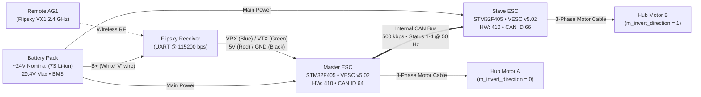
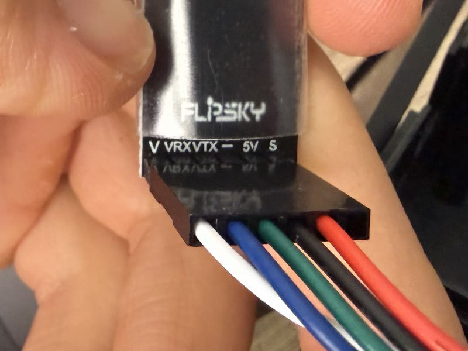
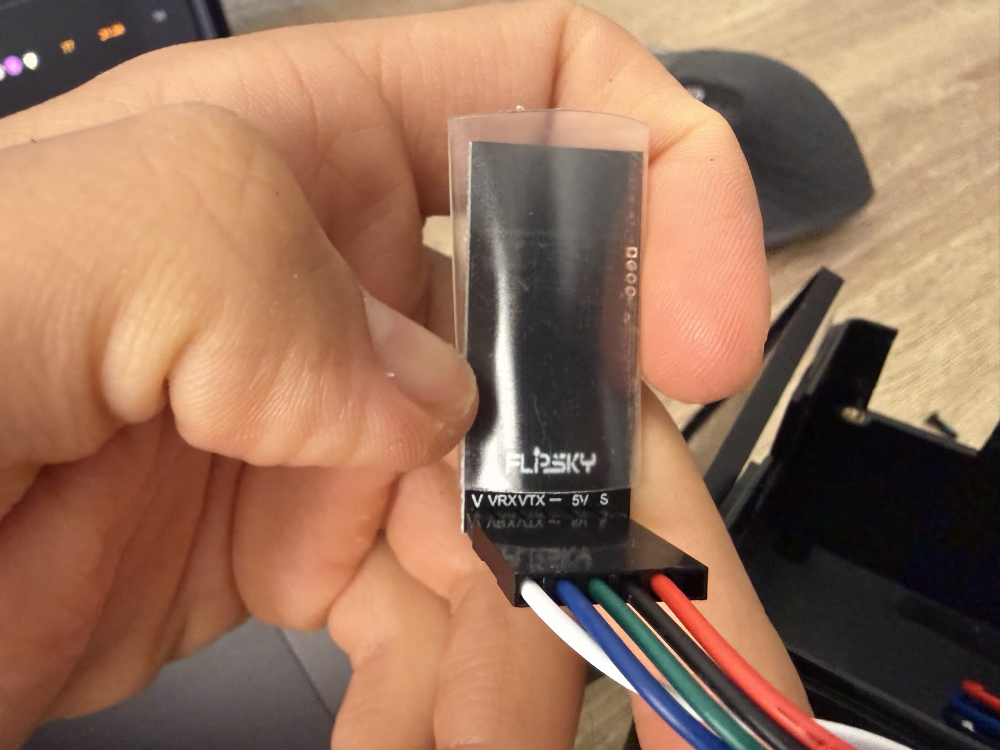
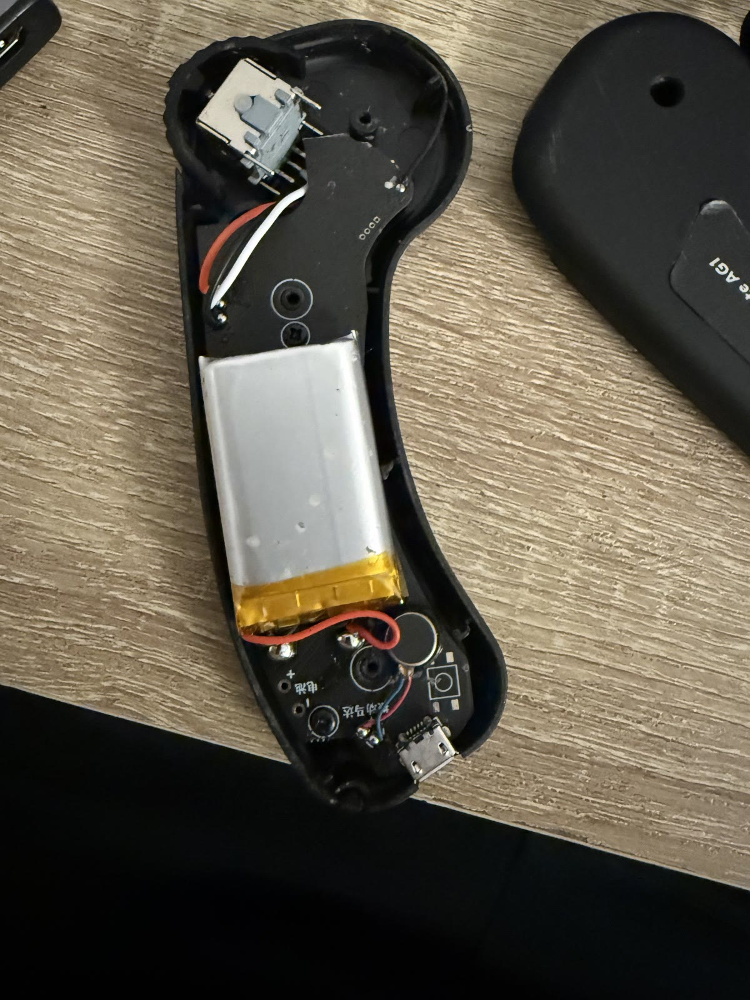

# 01 — Hardware Architecture

AtmosGear electric inline skates use a **waist-mounted power & controller pack** connected via flexible leg cables to **two central hub-motor wheels** (one per skate). Internally, the electronics are built on standard **open-source VESC-compatible** hardware paired with an OEM **Flipsky VX1** wireless remote system.

---

## System Overview

---

## Verified Component Summary

| Subsystem | Observed Specification | Notes |
| :--- | :--- | :--- |
| **Microcontroller** | Dual **STM32F405** | One independent VESC controller per skate |
| **Firmware Reported** | **VESC v5.02** | Standard `MCCONF` (`0x83d6207a`) & `APPCONF` (`0xc29ad144`) signatures |
| **Hardware Target** | **VESC `410`** | Classic VESC 4.10 / 4.12 / Dual FSESC 4.20 class architecture |
| **CAN Topology** | **Master ID `64`** ↔ **Slave ID `66`** | `500 kbps` (`can_baud_rate = 2`), `CAN_STATUS_1_2_3_4` at `50 Hz`, `multi_esc = true` |
| **UART Interface** | `115200` baud, 3.3V TTL logic | Connects Flipsky receiver (`VRX`/`VTX`) to Master ESC |
| **Wireless Remote** | **AtmosGear Remote AG1** | Rebranded **Flipsky VX1** (thumbwheel pot, LiPo cell, vibration motor, charge-only micro-USB) |
| **Receiver** | **Flipsky VX1 Receiver** | Wired purely for **UART** (`S` / PPM pin is unconnected); battery voltage sensed via `V` wire |
| **Battery Pack** | ~**24V nominal** (~7S Li-ion, up to 29.4V; ~280 Wh) | Observed at `27.1 V` during testing; LVC is managed by the pack's **BMS** (VESC cutoffs left at `10.2 V` / `9.0 V`) |
| **Motors** | Dual central hub motors | Driven in **Sensorless FOC** (`foc_sensor_mode = 0`), ~`130–137 mΩ`, ~`37–38 µH`, ~`7.8 mWb` |

---

## Flipsky Receiver Connector Pinout

On the unit examined, the 6-pin black connector attached to the Flipsky receiver uses **5 wires** (`S` / PPM is unpopulated):

| Receiver Silkscreen | Wire Color | Signal Direction | Function |
| :---: | :---: | :--- | :--- |
| **`V`** | White | Battery B+ → Receiver | Direct analog battery voltage sensing for the remote's 4 battery LEDs |
| **`VRX`** | Blue | Receiver TX → VESC RX | Outgoing VESC UART control frames (`COMM_SET_CHUCK_DATA` @ ~100 Hz) |
| **`VTX`** | Green | VESC TX → Receiver RX | Incoming VESC UART line (3.3V logic; unused for RPM polling in captured tests) |
| **`-`** | Black | Common GND | Ground reference |
| **`5V`** | Red | VESC 5V → Receiver | 5V power supply for the receiver module (internally regulated to 3.3V logic) |
| **`S`** | *(Empty)* | — | PPM signal pin — **not connected** |

---

## Remote AG1 Internal Hardware

Opening the `Remote AG1` housing confirms it uses standard Flipsky VX1 electronics:

- **Top:** Spring-centered thumbwheel potentiometer for throttle/brake.
- **Middle:** Single-cell 3.7V pouch LiPo battery (`电池` pads) and an unpopulated 4-pin SWD/programming header (`oooo`).
- **Bottom:** Coin vibration motor (`震动马达`), push-button switches, and a **micro-USB port wired for charging only** (no USB data/serial interface is exposed when plugged into a computer).
