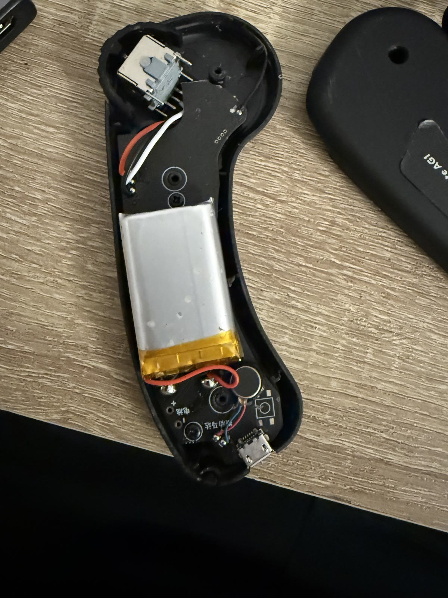

# 03 — AtmosGear Remote AG1 (Flipsky VX1) Guide & UART Protocol

The handheld controller shipped with AtmosGear skates (**Remote AG1**) is an OEM-branded **Flipsky VX1** wireless remote operating over 2.4 GHz with a UART receiver.

---

## 1. Controls & LED Indicators

### Physical Controls
- **Thumbwheel (top):** Push forward to accelerate, release to freewheel/coast, pull back to apply regenerative braking (and reverse from standstill if enabled in VESC `APPCONF`).
- **Right Button (`⏻` Power):**
  - **Long press (~3 s):** Power remote ON / OFF.
- **Left Button (Mode / Settings):**
  - **Short press (1 click):** Cycles through the **3 speed / power modes** (indicated by the 4 central LEDs and vibration feedback).
  - **Long press (~2 s):** Enters the **Battery Cell Count Calibration menu** (blinking red LEDs).
- **Micro-USB Port (bottom):** **Charging only.** Plugging it into a computer does not enumerate any USB device or serial port.

### LED Layout (Top to Bottom)
1. **Top LED (Wi-Fi / signal icon):** Green when connected to the receiver; blinks when searching/disconnected.
2. **4 Central LEDs (skate icon):**
   - Normally show the **skate battery pack charge level** (read from the white `V` wire on the receiver).
   - Briefly show the active **speed mode** when pressing the left button.
   - Blink **red** when configuring the battery cell count (`6S / 8S / 10S / 12S`).
3. **Bottom LED (battery icon):** Charge indicator for the **remote's internal LiPo battery**.

---

## 2. Live-Measured Speed Modes (Captured via UART)

By connecting the Flipsky receiver directly to a Raspberry Pi (`115200` baud) and recording **4,568 consecutive frames** across 45 seconds using [`tools/analyze_flipsky.py`](../tools/analyze_flipsky.py), we verified the exact throttle values sent by the receiver via standard VESC `COMM_SET_CHUCK_DATA` (`0x23`):

- **Packet rate:** ~`100 Hz` (16 bytes per VESC frame)
- **Neutral:** `js_x = 127`, `js_y = 128`, `bt_c = 0`, `bt_z = 0`, `acc = (0, 0, 0)`
- **Full brake (all modes):** `js_y` goes down to **`1`** (`100%` braking available in every mode)

| Speed Mode | Left Button LEDs | Neutral `js_y` | Max Forward `js_y` | Effective Forward Throttle Ceiling | Max Brake `js_y` |
| :---: | :---: | :---: | :---: | :---: | :---: |
| **Mode 1 (Low)** | 1 LED | `128` | **`191`** | **~50%** (`+63 / 127`) | `1` (`100%`) |
| **Mode 2 (Medium)** | 2 LEDs | `128` | **`209`** | **~64%** (`+81 / 127`) | `1` (`100%`) |
| **Mode 3 (High)** | 3–4 LEDs | `128` | **`255`** | **100%** (`+127 / 127`) | `1` (`100%`) |

> **Note on spring rebound:** Releasing the thumbwheel abruptly from full throttle can momentarily bounce past neutral to `js_y ≈ 87–93` for ~50 ms before settling at `128`. The factory VESC `hyst = 15%` (`±19` steps around `128`) and `ramp_time_neg = 0.40 s` absorb most of this transient.

---

## 3. Hidden Red Blinking LED Menu — Battery Cell Calibration (`6S / 8S / 10S / 12S`)

Many riders discover this menu by accident and wonder why the 4 central LEDs start blinking red and why the skate battery gauge seems inaccurate afterwards.

### What It Does
Holding the **left button** for ~2 seconds enters the Flipsky VX1 **battery voltage scale selector**. This does **not** affect speed, torque, braking, or skating assist — it **only** tells the remote how many lithium cells in series (`S`) your battery pack has, so it can map the voltage measured on the white **`V`** wire to the 4 central battery bars.

### How to Configure It
1. Turn the remote **ON**.
2. **Press and hold the left button (~2 s)** until the central red LEDs start blinking.
3. **Short-press the left button** to cycle through the 4 voltage presets:

| Blinking Red LEDs | Configured Pack | Approximate Voltage Range | Behavior on AtmosGear (~24V / 7S Pack, 21–29.4 V) |
| :---: | :---: | :---: | :--- |
| **1 Red LED** | **6S** | `18.0 – 25.2 V` | Reads **100% full** almost until battery is nearly depleted |
| **2 Red LEDs** | **8S** | `24.0 – 33.6 V` | **Recommended compromise** — warns before empty (won't show all 4 bars even when fully charged) |
| **3 Red LEDs** *(VX1 default)* | **10S** | `30.0 – 42.0 V` | Always reads **empty / critical** on a 7S pack |
| **4 Red LEDs** | **12S** | `36.0 – 50.4 V` | Always reads **empty / critical** on a 7S pack |

4. **Press and hold the left button again (~2 s)** to save and exit (LEDs stop blinking).

---

## 4. Pairing / Binding (Standard Flipsky VX1 Procedure)

If the remote ever loses pairing with the receiver:
1. Keep the skates/receiver **powered OFF**.
2. Turn the remote **ON**, then hold **both** the **Power (`⏻`)** and **Left (Mode)** buttons simultaneously for ~3 seconds until the remote vibrates and the signal LED flashes rapidly.
3. Power **ON** the skates/receiver within ~30 cm of the remote.
4. Once bound, the signal LED turns solid green.

---

## 5. UART Protocol Verification Result

Across **45 seconds** of continuous live sniffing (`4,568` packets, `73,088` bytes total) — even with our script emulating a VESC v5.02 spinning at `5000 ERPM`:
- **100%** of frames sent by the receiver were `COMM_SET_CHUCK_DATA` (`0x23`).
- **`0` packets** of `COMM_GET_VALUES` (`0x04`), `COMM_GET_VALUES_SELECTIVE` (`0x32`), `COMM_SET_CURRENT` (`0x06`), or any custom telemetry command were ever sent by the receiver.
- `bt_c` (Cruise Control) and `bt_z` remained `0` throughout standard operation.

This confirms the Flipsky VX1 receiver is a purely one-way throttle transmitter in this setup and **does not poll wheel RPM from the VESC**.
