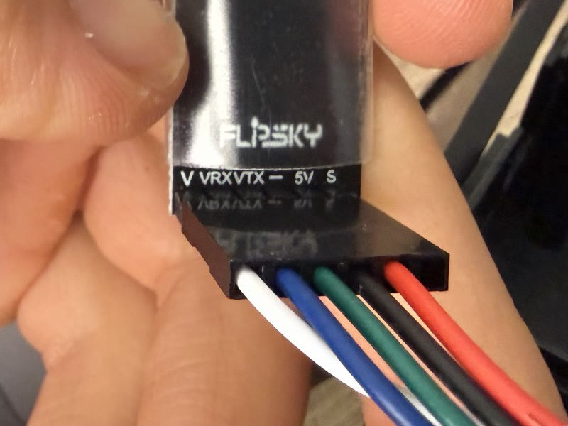
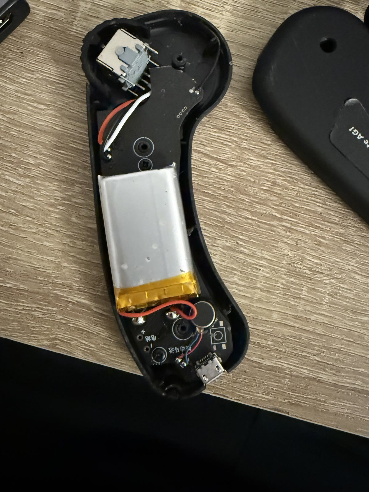

# Guía Técnica Completa en Español — AtmosGear Electric Skates

Esta guía recoge toda la ingeniería inversa, mapas de pines, volcados reales de fábrica VESC v5.02 y análisis del mando **Remote AG1 (Flipsky VX1)** obtenidos en vivo sobre unos patines eléctricos **AtmosGear**.

---

## 1. Arquitectura de Hardware

Los patines AtmosGear llevan la batería y la doble controladora dentro de la riñonera, con cables flexibles bajando hasta el motor hub de la rueda central de cada patín. Por dentro utilizan hardware estándar del ecosistema **VESC**:

- **Procesadores:** Doble **STM32F405** (uno por patín).
- **Firmware reportado:** **VESC v5.02** (`HW: 410`).
- **Firmas de configuración:** `MCCONF = 0x83d6207a` (458 bytes) y `APPCONF = 0xc29ad144` (419 bytes) — idénticas al VESC v5.02 oficial.
- **Topología bus CAN interno:**
  - Patín Maestro: **CAN ID `64`**
  - Patín Esclavo: **CAN ID `66`**
  - Velocidad: **500 kbps**, enviando `CAN_STATUS_1_2_3_4` a **50 Hz** y con `multi_esc = True`.
- **Puerto UART:** `115200` baudios, lógica **3.3V TTL**.
- **Mando inalámbrico:** **AtmosGear Remote AG1** (es un **Flipsky VX1** remarcado). Su puerto micro-USB es **solo de carga** (no expone datos por USB).
- **Batería:** Pack nominal de ~**24 V** (~7S Li-ion, 29.4 V llena; medida a `27.1 V`). El corte por bajo voltaje real lo gestiona el **BMS** de la batería (en el VESC viene dejado en `10.2 V / 9.0 V`).

---

## 2. Pinout del Receptor Negro Flipsky (UART)



El receptor va cableado **100% por UART** (el pin `S` de PPM está vacío):

| Pin en la placa | Color del cable | Dirección / Función |
| :---: | :---: | :--- |
| **`V`** | Blanco | Positivo directo de batería (`B+`) para medir el nivel de carga en los 4 LEDs del mando |
| **`VRX`** | Azul | Salida TX del receptor → Entrada RX del VESC (`COMM_SET_CHUCK_DATA` a ~100 Hz) |
| **`VTX`** | Verde | Salida TX del VESC → Entrada RX del receptor (lógica 3.3V) |
| **`-`** | Negro | Masa (`GND`) |
| **`5V`** | Rojo | Alimentación `5V` del receptor (regulada internamente a 3.3V) |
| **`S`** | *(vacío)* | Señal PPM — no utilizada |

---

## 3. Configuración de Fábrica VESC v5.02 (Decodificada)

Todos los volcados binarios originales están en [`configs/factory_vesc_5.02/`](../configs/factory_vesc_5.02/) y pueden inspeccionarse con [`tools/decode_vesc_conf.py`](../tools/decode_vesc_conf.py).

### Diferencias en `APPCONF` frente a VESC v5.02 por defecto (solo 6 campos de 149)

| Parámetro | Fábrica VESC 5.02 | Maestro (ID 64) | Esclavo (ID 66) | Significado |
| :--- | :---: | :---: | :---: | :--- |
| `controller_id` | `11` | **`64`** | **`66`** | ID único en el bus CAN |
| `send_can_status` | `0` | **`4`** | **`4`** | Emite `CAN_STATUS_1_2_3_4` a 50 Hz |
| `app_chuk_conf.ramp_time_pos` | `0.40 s` | **`0.80 s`** | **`0.80 s`** | Suavizado de aceleración |
| `app_chuk_conf.ramp_time_neg` | `0.20 s` | **`0.40 s`** | **`0.40 s`** | Suavizado de frenada |
| `app_chuk_conf.use_smart_rev` | `1` (`True`) | **`0`** (`False`) | **`0`** (`False`) | Smart Reverse desactivado |
| `app_chuk_conf.smart_rev_max_duty` | `0.07` | **`0.0`** | **`0.0`** | Duty de Smart Reverse a cero |

Otros valores relevantes de `APPCONF`: `app_to_use = 3` (`APP_UART`), `ctrl_type = 1` (*Current with Reverse*), zona muerta `hyst = 15%`, curva lineal (`throttle_exp = 0.0`), `multi_esc = True`, control de tracción `tc = False`, `timeout_msec = 1000 ms` con `timeout_brake_current = 0.0 A` (rueda libre si se pierde señal).

### Parámetros clave de motor (`MCCONF`)

| Parámetro | Maestro (ID 64) | Esclavo (ID 66) | Nota |
| :--- | :---: | :---: | :--- |
| `motor_type` / `foc_sensor_mode` | `FOC` / `Sensorless` | `FOC` / `Sensorless` | Control FOC sin sensores Hall activos |
| `l_current_max` / `l_current_min` | **`+22.0 A` / `-22.0 A`** | **`+22.0 A` / `-22.0 A`** | Corriente máxima por patín (aceleración y freno regenerativo) |
| `l_abs_current_max` | `150.0 A` | `150.0 A` | Límite absoluto de protección |
| `l_max_duty` / `l_max_erpm` | `95%` / `100,000` | `95%` / `100,000` | Sin tope artificial de ERPM en `MCCONF` |
| `l_temp_fet_start` / `l_temp_fet_end` | `85 °C` / `100 °C` | `85 °C` / `100 °C` | Protección térmica MOSFETs |
| `foc_motor_r` | `0.1303 Ω` | `0.1373 Ω` | Resistencia medida de fase |
| `foc_motor_l` | `37.11 µH` | `38.04 µH` | Inductancia medida |
| `foc_motor_flux_linkage` | `7.755 mWb` | `7.936 mWb` | Flujo magnético medido |
| `foc_observer_gain` | `16.63 × 10⁶` | `15.88 × 10⁶` | Ganancia del observador sensorless |
| `foc_current_kp` / `ki` | `0.0371` / `130.34` | `0.0380` / `137.27` | Lazo PI de corriente FOC |
| `foc_openloop_rpm` / `foc_sl_erpm` | `1400` / `4000` | `1400` / `4000` | Arranque open-loop y transición sensorless |
| `m_invert_direction` | **`0` (False)** | **`1` (True)** | Giro invertido porque los motores van enfrentados |

---

## 4. Guía Completa del Mando Remote AG1 (Flipsky VX1)



### Botones y modos de velocidad (medidos en vivo por UART)

El receptor envía paquetes `COMM_SET_CHUCK_DATA` (`0x23`) a ~100 Hz con neutro en `js_y = 128`:

| Modo (1 toque corto botón izquierdo) | LEDs | Tope aceleración `js_y` | Potencia efectiva | Tope freno `js_y` |
| :--- | :---: | :---: | :---: | :---: |
| **Modo 1 (Lento)** | 1 LED | **`191`** | **~50%** | `1` (100%) |
| **Modo 2 (Medio)** | 2 LEDs | **`209`** | **~64%** | `1` (100%) |
| **Modo 3 (Rápido)** | 3–4 LEDs | **`255`** | **100%** | `1` (100%) |

### Menú oculto de luces rojas parpadeantes (Calibración de batería 6S / 8S / 10S / 12S)

Al **mantener pulsado el botón izquierdo (~2 s)**, los 4 LEDs centrales empiezan a parpadear en rojo. Ese menú **NO cambia la velocidad ni activa modos de patinaje**: solo configura cuántas celdas en serie (`S`) tiene la batería de los patines para traducir el voltaje del cable blanco `V` a las 4 rayas de batería:

| LEDs rojos parpadeando | Batería configurada | Rango de voltaje | En AtmosGear (~24 V / 7S, 21–29.4 V) |
| :---: | :---: | :---: | :--- |
| **1 LED** | **6S** | 18.0 – 25.2 V | Marca 100% casi todo el tiempo hasta agotarse |
| **2 LEDs** | **8S** | 24.0 – 33.6 V | **Opción más recomendable** para avisar antes de quedarse sin batería |
| **3 LEDs** *(defecto VX1)* | **10S** | 30.0 – 42.0 V | Marca siempre descargada |
| **4 LEDs** | **12S** | 36.0 – 50.4 V | Marca siempre descargada |

Pulsa corto el botón izquierdo para elegir 1, 2, 3 o 4 luces y vuelve a **mantenerlo pulsado ~2 s** para guardar.

---

## 5. Conexión con Raspberry Pi y Puente Wi-Fi para VESC Tool

### A) Raspberry Pi ↔ Receptor Flipsky (patines desconectados)

```text
Pin 2  [ 5V ]  <-- ROJO (5V)      (Pin 4 si no lo ocupa un ventilador)
Pin 8  [ TXD ] <-- VERDE (VTX)
Pin 9  [ GND ] <-- NEGRO (-)      (o Pin 6 / Pin 14)
Pin 10 [ RXD ] <-- AZUL (VRX)
Blanco (V) y hueco S: SIN CONECTAR
```

Ejecuta el analizador:
```bash
python3 tools/analyze_flipsky.py --port /dev/serial0 --duration 30 --fake-vesc --erpm 5000
```

### B) Raspberry Pi ↔ Placa VESC de los patines (receptor quitado)

Conecta **solo 3 cables** (`GND`, `TX → Pin 10 RXD`, `RX → Pin 8 TXD`; **nunca conectes `5V` ni `V`**) y abre el puente TCP para conectarte desde **VESC Tool** por Wi-Fi (puerto `65102`):

```bash
socat TCP-LISTEN:65102,reuseaddr,fork FILE:/dev/serial0,b115200,raw,echo=0
```

---

## 6. Conclusión sobre el «Impulso Automático al Patinar»

1. En `APPCONF` y `MCCONF` **no existe ningún parámetro de asistencia** (ni PAS) activado.
2. En **45 segundos y 4.568 paquetes** espiados al receptor Flipsky (incluso simulando 5.000 ERPM desde la Raspberry Pi), el receptor envió **100% paquetes `COMM_SET_CHUCK_DATA`** y **0 peticiones `COMM_GET_VALUES`** — jamás pregunta las RPM al VESC.
3. Por tanto, el impulso automático al coger velocidad **no proviene del mando ni del receptor**, sino del **código interno del firmware STM32F405** de los patines. Los próximos pasos de investigación están documentados en [`docs/05-push-assist-investigation.md`](05-push-assist-investigation.md).
